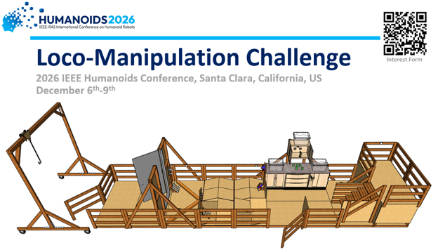

# IEEE Humanoids 2026 Loco-Manipulation Challenge 

To guarantee eligibility for Travel Grants, your team must register for the competition by submitting a brief team description paper by **the end of October (11:59pm, October 31st, Anywhere on Earth).**

## Objective

The Loco-Manipulation Challenge will consist of a single testing apparatus that contains a number of locomotion/mobility tasks and manipulation tasks. The arena includes a variety of reproducible terrains, obstacles, and manipulation tasks with varying difficulty to challenge all levels of robot performance. The goal of the competition is to evaluate baseline humanoid robot mobility, manipulation/dexterity, and reasoning capabilities. Competition participants will be able to compare performance with the best humanoid robots in the world, which will be evaluated on similar tests before and after the competition. Results from the competition will also help inform where the research field is relative to the commercial sector.

## Rules and Test Procedures

A detailed description of the competition testbed, tasks, and rules is provided in the competition description document. The tests will consist of several cross-cutting basic tasks arranged in a circuit, separated into mobility and manipulation focused tasks.  Autonomy will be incentivized, but teleoperation or remote operation will still score points.

Download Competition Rules and Description Document: [Rules](Humanoid-Conference-Competition-Rules.pdf)

## Planned Schedule

The competition will happen over three days at the IEEE Humanoids Conference. There will be one practice day, and two competition days in which all teams will have the opportunity to perform the mobility, manipulation, and combined loco-manipulation sets of tasks, as described in the rules document.

## Participation

All teams interested in participation can fill out the [Team Participation Interest Form](https://forms.gle/1ovrtVQSS84WTGP56), sharing the level of intent to participate and guaranteeing you will be kept informed when more details are released. 

Final application to participate will be done via the submission of a brief Team Description Paper (TDP) with overview information about your team and robot. 

The Latex template for the TDP can be found here: [Template](TDP-Template)

Once Complete the TDP can be submitted via EasyChair. Follow this link, create an account if needed, and submit: [https://easychair.org/conferences/?conf=2026humanoidscompeti](https://easychair.org/conferences/?conf=2026humanoidscompeti)

**Due Date: 11:59pm, October 31st, Anywhere on Earth**

*Team Description Papers must be submitted by the end of October to be guaranteed eligibility for travel Grants.*

## Travel Grants

Thanks to sponsors of the conference and competition there is a potential for travel awards being made available to participating teams to aid in covering travel expenses. These awards are not guaranteed, but if available will be distributed as fairly as possible to teams who submit a TDP. Please indicate interest on the [Team Participation Interest Form](https://forms.gle/1ovrtVQSS84WTGP56).

## Robot Availability at the Conference

Thanks to the support of a sponsor of the competition, Ultimate Bots, several humanoid robots will be made available for teams to use at the competition. Available hardware will include a Unitree G1 and AgiBot X2 robot. Teams can utilize their own software, controllers, and other resources, but use the provided hardware for the competition to avoid having to travel with their own robot. Please express interest in the Team Participation Interest Form. More details will follow.

Download Additional Information for On-Site Robot Availability from Ultimate Bots: [Robot Availability Details](ultimate_bots_robot_access_humanoids2026.pdf)

## CAD Files 
3D models of the competition testbed are available here: [CAD-Files](CAD-Files)

Note that the simulation files (USD) do not currently include accurate friction, mass, and inertial parameters. 

## Build Plans
Full build plans for the testbed, including parts and instructions, is under development and will be released soon. 

## History of the Competition

Inspired by the DARPA Robotics Challenge (2013-2014), the IEEE/RAS LRC (2023-2026), the RoboCup Rescue International competition (2001-2026), and the NIST Humanoid Robot Baseline Benchmark currently under development. This competition will be designed and run by the same team as the above.

## Additional Questions:

If you have any additional questions about the competition, please contact the conference competition chairs at [humanoids2026-cc@ieee.org](humanoids2026-cc@ieee.org).
