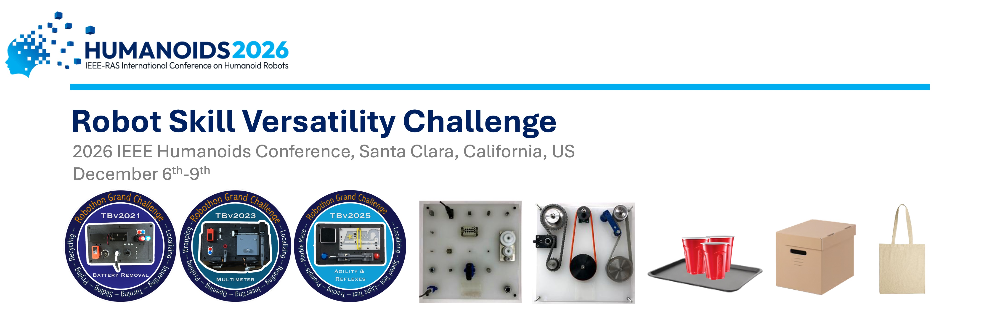
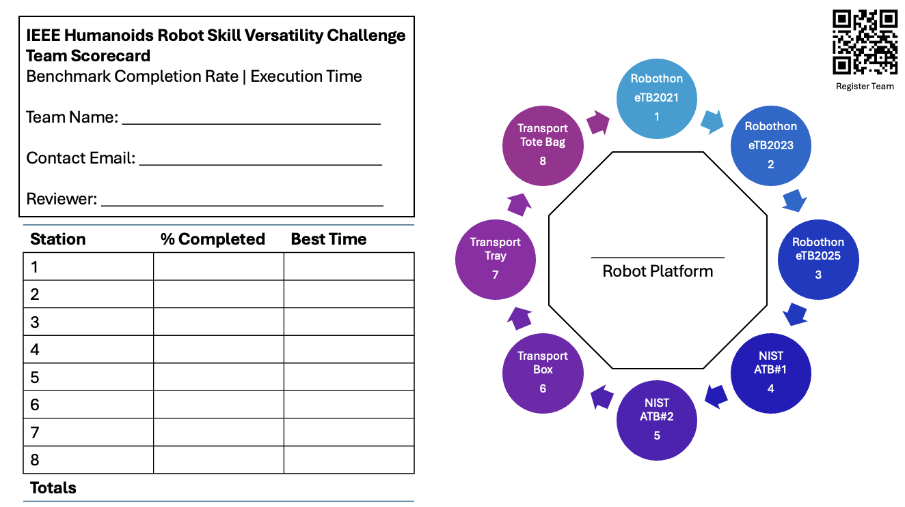

# IEEE Humanoids Robot Skill Versatility Challenge (RSCV) Track

## Overview
Alongside the Loco-Manipulation Challenge track several tables will offer a circuit of popular benchmark manipulation tasks referred to as the Robot Skill Versatility Challenge for competition participants and robot vendors to attempt during the conference. Attempts are graded pass/fail and differentiated by execution time. The robot team with the most completed tasks and fastest times for the RSVC track will be recognized on stage during the final day of the conference and highlighted by the on-site media team. 

The RSVC circuit manipulation tasks include the following test stations:

| Station | Benchmark Task Description                                               | Instructions  | Scoring Pass/Fail | More Info  |
|---------|--------------------------------------------------------------------------|---------------|---------|---|
|    1    | Robothon Electronic Task Board (eTB2021): Battery Removal                | [Test Protocol](../imgs/eTB2021_Robot-Human_Protocol.jpeg)     [Manual](./Robothon_eTB2021_Protocol.pdf) | 6 tasks      | [CAD](../CAD-Files/Robothon_eTB2021/eTB2021.stl)     [Dashboard](https://cloud.kaaiot.com/wd-public/c1v9jqmgul2l1s47m6bg/dashboards/dashboard2/931cb10a-3044-49c8-8530-5ce0951e291b?public_id=4e4990d1-dcab-4f1a-b1a6-8648e87bc5ad) |
|    2    | Robothon Electronic Task Board (eTB2023): Multimeter Use                 | [Test Protocol](../imgs/eTB2023_Robot-Human_Protocol.jpeg)     [Manual](./Robothon_eTB2023_Protocol.pdf) | 6 tasks      | [CAD](../CAD-Files/Robothon_eTB2023/eTB2023.stl)   Sim   [Dashboard](https://cloud.kaaiot.com/wd-public/c1v9jqmgul2l1s47m6bg/dashboards/0d2f0e4c-6a80-4cf4-a48d-5b25fcb35ac0/19addcfa-9cf1-42b3-8bd3-32a1feb4abdb?public_id=4e4990d1-dcab-4f1a-b1a6-8648e87bc5ad) |
|    3    | Robothon Electronic Task Board (eTB2025): Reaction Time, Screen/Tool Use | [Test Protocol](../imgs/eTB2025_Protocol.jpeg)     [Manual](./Robothon_eTB2025_Protocol.pdf) | 6 tasks      | [CAD](../CAD-Files/Robothon_eTB2025/eTB2025.stl)     [Dashboard](https://cloud.kaaiot.com/wd-public/c1v9jqmgul2l1s47m6bg/dashboards/8ce30d1f-bd06-4d15-9d51-69970b069975/931cb10a-3044-49c8-8530-5ce0951e291b?public_id=4e4990d1-dcab-4f1a-b1a6-8648e87bc5ad) |
|    4    | NIST Assembly Task Board ATB#1: Insertion                                | [Test Protocol](./Benchmark_NIST_Assembly_Task_Board_1_V1.0.pdf) | 10 tasks     | N/A  |
|    5    | NIST Assembly Task Board ATB#2: Pulleys                                  | [Test Protocol](./Benchmark_NIST_Assembly_Task_Board_2_V1.0.pdf) | 3 tasks     | N/A  |
|    6    | Transport Tray with Cups                                                 | [Test Protocol](../imgs/transport_cups.jpeg) | 3 tasks     | N/A  |
|    7    | Transport Cardboard Box                                                  | [Test Protocol](../imgs/transport_box.jpeg) | 3 tasks     | N/A  |
|    8    | Transport Weighted Tote Bag                                              | [Test Protocol](../imgs/transport_tote.jpeg) | 3 tasks     | N/A  |

## Rules and Test Procedures

The manipulation tasks will be provided on dedicated tables where teams can approach each set up with their robot platform for their trial attempt. Each test artifact has a fixed test protocol to be executed by the robot either via teleoperation or autonomously. Autonomous solutions are preferred and therefore, receive a 2X multiplier in scored points. 

The electronic task board (eTB) manipulation benchmarks model industrial use cases and provide a streamlined platform for comparing human and robot manipulation performance with automated scoring. Each eTB has integrated performance circuits to electronically verify, score, and report trial attempts. Task board sensor values, protocol progress, and task completion are available as ROS2 messages over a local WiFi network. Learn more on the trial protocols on the [Electronic Task Board project repository](https://github.com/peterso/robotlearningblock/)

NIST Prototype Assembly Task Boards (ATBs) are manipulation and assembly benchmarks representing endorsed by NIST. Learn more about the test protocol and scoring details on the [NIST ATB project website](https://www.nist.gov/el/intelligent-systems-division-73500/robotic-grasping-and-manipulation-assembly/assembly). 

The transport tasks involve picking the readily available objects, including a food serving tray with cups filled with foam cubes, cardboard boxes, and a tote bag, from a demarcated start region with the goal to move them to a target goal region and will be scored based on success rate and timing. A designated test area will be set up for the transport tasks alongside the Loco-Manipulation track. See the schedule below. 

Here is an overall [RSVC Scorecard](./RSVC_Team_Scorecard.pdf) to record the best performance of each team. 

## Planned Schedule
The benchmark artifacts will be mounted on tables directly next to the Loco-Manipulation competition to be used by participating teams throughout the duration of the conference. All trial attempts to be considered for stage recognition, with the exception for the transport tasks, must be completed and verified by a judge by Wednesday morning (12:00pm cutoff). The transport tasks will be demonstrated during designated time slot on Wednesday afternoon live in front of a jury. Top performing teams will be informed ahead of their stage appearance at the award ceremony on Wednesday at 17:30. See the [conference program](https://2026.ieee-humanoids.org/program-overview/) for the latest information.

## Participation
Participating teams need to bring their own robot or use a conference robot provided by the competitions sponsor, Ultimate Bots. Teams may register in advance or on-site at the conference by complete the [RSVC Team Participation Form](https://docs.google.com/forms/d/e/1FAIpQLSdpcd9YQFgipDDQ5jbZhp9j81TaBrushN6hIw2Kll1YkBkNKA/viewform?usp=publish-editor). 

## History of the Benchmark Artifacts
The Internet-connected electronic task boards debuted at the [Robothon Grand Challenge](https://automatica-munich.com/en/munich-i/robothon/) at the automatica trade show (2021-2025) as a distributed competition reference device. Additional appearances were made at the [Tactile Manipulation Hackathon](https://franka.de/news/franka-emika-hosts-hackathon-at-european-robotics-forum-2022) at the European Robotics Forum 2022 and at the [Manipulation Skill Versatility Challenge](https://sites.google.com/view/eurobin-msvc/) at the IROS 2024 in Abu Dhabi. The [Robothon Grand Challenge Archive](https://github.com/peterso/robothon-grand-challenge) holds a collection of community contributed robot solutions for each electronic task board design. 

## Additional Questions
If you have any additional questions about the competition, please contact the conference competition chairs at humanoids2026-cc@ieee.org.
